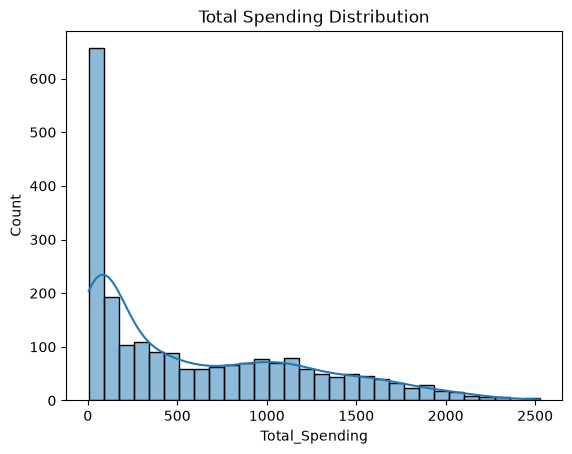
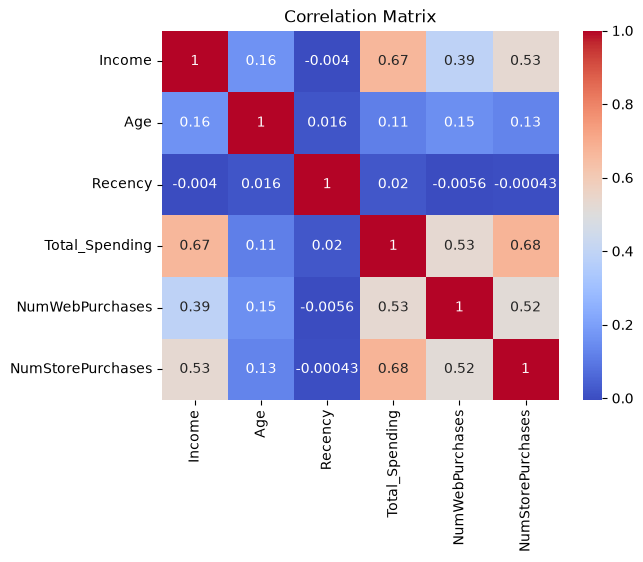
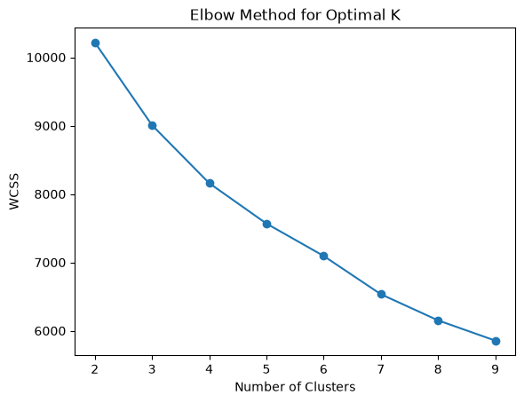
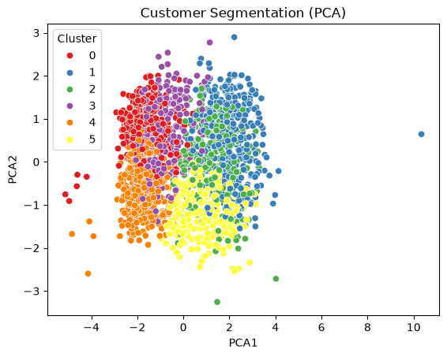
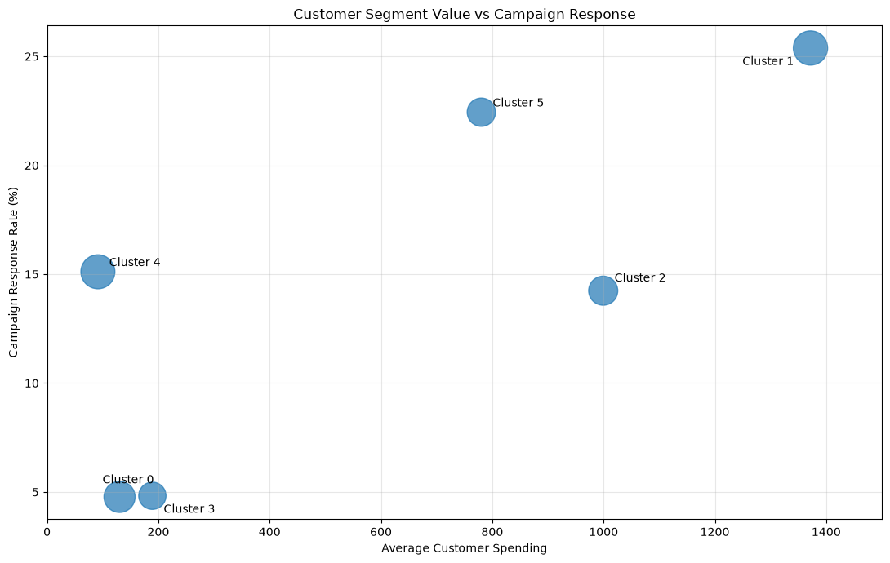
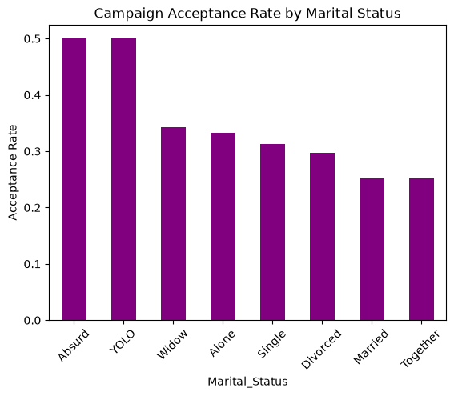

# Customer Segmentation and Marketing Intelligence

An end-to-end data analytics and machine learning project combining customer segmentation, purchasing behaviour analysis and campaign performance evaluation to support data-driven marketing decisions.

## 1. Business Problem

Businesses often treat their entire customer base similarly when planning marketing campaigns. However, customers differ in income, purchasing behaviour, spending patterns and responsiveness to promotions.

Marketing resources are limited. Therefore, the business needs to understand:

- Which customer groups contribute the most to total spending?
- Which segments demonstrate stronger campaign responsiveness?
- How do purchasing patterns differ across customer groups?
- Where should marketing teams prioritise retention, engagement and promotional efforts?

**Project Objective:** Identify meaningful customer segments using K-Means clustering and translate the resulting patterns into practical marketing and customer prioritisation strategies.

## 2. Project Overview

This project combines two complementary analytical stages:

| Stage | Focus | Outcome |
|---|---|---|
| Customer Analytics | Data cleaning, exploratory analysis and feature engineering | Understanding customer demographics, spending and purchasing behaviour |
| Customer Segmentation & Business Intelligence | K-Means clustering and segment-level analysis | Six customer groups with spending, purchasing and campaign insights |

## 3. Dataset Overview

The analysis uses a customer marketing dataset containing demographic information, product spending, purchasing channels and historical campaign responses.

| Metric | Value |
|---|---:|
| Original customer records | 2,240 |
| Missing income records | 24 |
| Records retained for clustering | 2,216 |
| Duplicate records | 0 |
| Customer segments identified | 6 |
| Features used for clustering | 7 |

### Data Quality

- Identified 24 missing values in the Income column.
- Found no duplicate records.
- Investigated unusually high income values and unusual birth years.
- Excluded records without complete clustering features from model assignment.

## 4. Exploratory Data Analysis

The initial analysis examined:

- Customer income and demographic characteristics.
- Spending across six product categories.
- Purchasing activity across web, catalogue and store channels.
- Customer recency and tenure-related information.
- Historical campaign acceptance patterns.
- Relationships between income, spending and purchasing behaviour.

### Business Metrics Created

- **Total Spending:** Combined spending across wines, fruits, meat, fish, sweets and gold products.
- **Total Purchases:** Combined web, catalogue and store purchases.
- **Campaigns Accepted:** Number of previous marketing campaigns accepted.

Overall customer spending had a mean of 605.80 and a median of 396.00, indicating substantial variation across customers.

## 5. Feature Engineering

Seven features were selected for customer segmentation:

| Feature | Business Meaning |
|---|---|
| Age | Customer age |
| Income | Customer income |
| Total_Spending | Spending across product categories |
| NumWebPurchases | Online purchasing activity |
| NumStorePurchases | Physical store purchasing activity |
| NumWebVisitsMonth | Monthly website visits |
| Recency | Days since the last purchase |

The selected features were standardised using `StandardScaler` before clustering to place variables on comparable scales.

## 6. Machine Learning Methodology

**Algorithm:** K-Means Clustering

The Elbow Method was used to investigate the appropriate number of clusters. A six-cluster configuration was selected.

The modelling workflow:

1. Prepare the customer dataset.
2. Engineer customer age and total spending.
3. Select seven behavioural and demographic features.
4. Standardise the selected features.
5. Evaluate cluster counts using the Elbow Method.
6. Apply K-Means clustering with six clusters.
7. Use PCA to visualise the customer segments in two dimensions.
8. Save and reuse the trained K-Means model and scaler.

### Model Configuration

| Component | Configuration |
|---|---|
| Algorithm | K-Means |
| Number of clusters | 6 |
| Input features | 7 |
| Scaling | StandardScaler |
| Cluster visualisation | Principal Component Analysis (PCA) |
| Model persistence | Joblib |

## 7. Customer Segment Analysis

The six segments demonstrate distinct spending and purchasing patterns.

| Cluster | Customers | Average Spending | Spending Share |
|---|---:|---:|---:|
| 0 | 377 | 130.27 | 3.65% |
| 1 | 457 | 1,371.80 | 46.60% |
| 2 | 330 | 999.33 | 24.51% |
| 3 | 290 | 189.21 | 4.08% |
| 4 | 450 | 91.36 | 3.06% |
| 5 | 312 | 780.42 | 18.10% |

### Key Segment Findings

**Cluster 1: Highest Spending Segment**

- 457 customers.
- Average spending: 1,371.80.
- Contributes 46.60% of total customer spending.
- Historical campaign response rate: 25.38%.

**Cluster 2: High-Value Purchasing Segment**

- 330 customers.
- Average spending: 999.33.
- Contributes 24.51% of total spending.
- Historical campaign response rate: 14.24%.

**Cluster 5: Recently Active, High-Spending Segment**

- 312 customers.
- Average spending: 780.42.
- Contributes 18.10% of total spending.
- Historical campaign response rate: 22.44%.
- Average recency: 17.15 days.

**Cluster 4: Campaign Testing Opportunity**

- 450 customers.
- Average spending: 91.36.
- Historical campaign response rate: 15.11%.

Despite relatively low spending, this segment demonstrated campaign responsiveness, making it a potential candidate for testing cost-effective promotions.

**Clusters 0 and 3: Lower-Spending Segments**

Both groups recorded relatively low average spending and historical campaign response rates below 5%. They may require different engagement strategies.

## 8. Campaign Performance Analysis

Historical campaign response rates varied across customer segments.

| Cluster | Campaign Response Rate |
|---|---:|
| 0 | 4.77% |
| 1 | 25.38% |
| 2 | 14.24% |
| 3 | 4.83% |
| 4 | 15.11% |
| 5 | 22.44% |

Cluster 1 recorded the highest response rate, followed by Clusters 5 and 4.

These results provide a basis for designing differentiated marketing campaigns rather than using the same promotional strategy for every customer.

## 9. Key Business Findings

1. **Spending concentration:** Clusters 1, 2 and 5 collectively account for 89.21% of total customer spending.
2. **Highest-value group:** Cluster 1 contributes 46.60% of total spending and has the highest historical campaign response rate.
3. **Customer engagement:** Cluster 5 combines relatively high spending with recent purchasing activity.
4. **Campaign opportunity:** Cluster 4 has a 15.11% historical response rate despite low average spending.
5. **Marketing prioritisation:** Clusters 0 and 3 may benefit from lower-cost, targeted engagement rather than expensive broad campaigns.

## 10. Business Recommendations

| Customer Segment | Recommended Strategy |
|---|---|
| Cluster 1 | Premium product recommendations, loyalty initiatives and retention campaigns |
| Cluster 2 | Personalised offers and targeted cross-selling |
| Cluster 5 | Retention campaigns and product recommendations |
| Cluster 4 | Test low-cost promotions and monitor incremental spending |
| Clusters 0 and 3 | Cost-conscious engagement and reactivation campaigns |

Campaign strategies should be validated through controlled experiments before increasing marketing expenditure.

## 11. Technologies and Tools

- **Programming:** Python
- **Data Analysis:** Pandas, NumPy
- **Visualisation:** Matplotlib, Seaborn
- **Machine Learning:** Scikit-learn, K-Means
- **Dimensionality Reduction:** PCA
- **Preprocessing:** StandardScaler
- **Model Persistence:** Joblib
- **Development Environment:** Jupyter Notebook

## 12. Project Files

| File | Description |
|---|---|
| `Customer_segmentation.ipynb` | Data cleaning, exploratory analysis, feature engineering, K-Means clustering and PCA visualisation |
| `Customer_Segmentation_Business_Intelligence.ipynb` | Application of the saved model, customer segment performance, campaign analysis and business recommendations |

## 13. Limitations

- The analysis is based on historical customer information.
- Twenty-four records had missing income values and were not assigned to clusters.
- K-Means results depend on feature selection, scaling and model configuration.
- Cluster numbers are identifiers, not rankings.
- Historical campaign response rates do not establish causal campaign effectiveness.
- Profitability cannot be determined without product costs and profit margins.
- Marketing recommendations require validation using controlled experiments.

## 14. Conclusion

This project demonstrates how customer segmentation can move beyond grouping customers by demographics and support practical business decisions through purchasing behaviour, spending patterns and campaign responsiveness.

The analysis identified six customer segments with distinct characteristics. Three segments accounted for 89.21% of total spending, while differences in historical campaign response highlighted opportunities for more targeted marketing strategies.

The key business insight is that effective customer marketing requires understanding not only how much customers spend, but also how they purchase and how they have responded to previous campaigns.

By combining machine learning with business intelligence, this project provides a structured approach to customer prioritisation and segment-specific marketing planning.

## 15. Visual Results

The following visualisations highlight customer spending patterns, feature relationships, cluster selection, customer segments and campaign response behaviour.

### 1. Customer Spending Distribution

### 2. Customer Feature Correlation

### 3. K-Means Elbow Method

### 4. Customer Segments — PCA Visualisation

### 5. Segment Value vs Campaign Response

### 6. Campaign Acceptance by Marital Status

